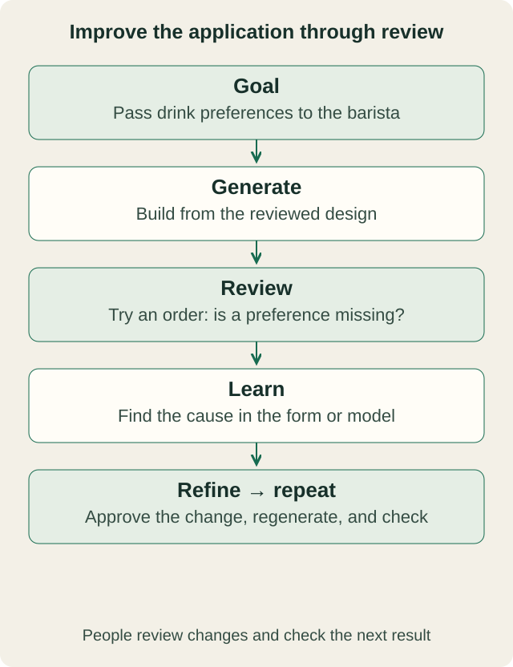

# Mimris: The App That Creates the App

Every application contains an understanding of how something works.

A form asks for certain information. A workflow decides who acts next. An approval button gives someone the authority to accept a result. Behind each of these features are decisions about how the work should happen.

If those decisions are wrong, generating more software can make the misunderstanding harder to undo.

Mimris starts with understanding the work. Its ambition is an AI workplace where people describe what they do, organize that knowledge into models, and use those models to create an application. We will call the result a **Generated Application**: an application that gives people the tasks, information, and tools they need to do their jobs.

The idea is straightforward: use one application to understand and design the work, then create another application in which people can perform it. Keep the design connected to the result so people can review and improve both.

Mimris already supports domain descriptions, saved models, workspace screens, and manual and AI-assisted drafting for tasks. The broader process described here is still being developed. Its specifications set out how application generation should work; they do not mean the complete process is already available.

## Understand the work first

The Coffee Shop World is Mimris’s demo setting for exploring this idea. Customers order products, employees take payment, baristas prepare drinks, and orders are handed over. The examples below build on that familiar setting to explain the intended Generated Application; they are illustrative design choices, not claims about a live shop or a finished generation pipeline.

Even this familiar process raises questions. Can one order contain several drinks? What information must pass from the cashier to the barista? When is an order ready for preparation? Does “complete” mean the drinks are prepared, or that the customer has received them?

These questions shape the application. If an order contains several drinks, each may need its own preparation details. If handover is a separate task, marking a drink as prepared should not also mark the whole order as collected.

Mimris uses models to record this understanding. A model describes the important things in the work, how they relate, who is responsible, and which rules apply. It gives people and AI something concrete to inspect and discuss.

Domain experts bring the knowledge. AI can help explain it, organize it, and propose a design. People still need to check the assumptions and decide what is right. Engineers still need to make the application secure, reliable, and able to connect to other systems.

## Turn the design into an application

For the coffee shop, a model could describe tasks such as Take Order, Accept Payment, Prepare Drink, and Hand Over Order. Each task would have a responsible role, required information, and an expected result.

The planned generation process uses these definitions to create forms, documents, checklists, and screens for moving through the work. An order form could capture the drink and customer preferences. Those details could then appear in the barista’s preparation view alongside the recipe and checklist.

The **Generated Application** brings these pieces together. A cashier should see what is needed to take an order and handle payment. A barista should see the drinks awaiting preparation and their details. The person handing over the order should be able to check that it is ready.

The application is **task-oriented**: people start with the job they need to do, with the relevant information and tools brought together around it. An included **Guide** explains the selected task, what information is needed, and what a finished result should contain.

**AI-assisted execution** adds help within that task context. In the coffee-shop example, a supervisor could ask AI to draft a stock request from the available inventory information, then check and revise it before approval. The Guide and AI assistance help people carry out the work; they do not replace their judgment or approve results on their behalf.

The model does not need to describe every pixel on the screen. It describes the work. Reusable software components provide the buttons, layouts, document tools, and other features people use to perform it.

The design should also explain where information comes from and where it is saved. Connecting to an existing point-of-sale or inventory system, for example, would require agreed field mappings and access permissions. Generating a form alone does not establish that connection.

## Try the workplace before final delivery

**Operational Preview** is the stage where people walk through the proposed application before final generation or export.

In the coffee-shop example, reviewers could use sample orders to follow the process from order entry through payment, preparation, and handover. Does the barista receive the customer’s preferences? Can the team track an order with two drinks? Is it clear which task comes next?

The specification requires Preview and the Generated Application to use the **same underlying model of the work**, compiled from the source models. That means the preview should show the tasks and structure intended for the application, with extra tools for testing and recording feedback.

Preview is a place to validate the design. It is not the final application, and a successful walkthrough does not prove that everything is ready for everyday use. Connections to real systems, saved data, access permissions, and reliability still need testing.

If the walkthrough reveals that the barista cannot see an important order detail, the team can return to the design, review a correction, and try again before final delivery.

## Make improvements where they belong

Creating applications repeatedly depends on reusable building blocks: models, templates, rules for generating screens and documents, and shared software features. The architecture also includes reusable task patterns, although these are not yet fully established as a separate part of the product.

When something goes wrong, the team needs to find the right place to fix it.

If the coffee-shop application misses the handover from payment to preparation, its workflow model may need changing. If required fields disappear from several generated forms, a generation rule may be wrong. If a button cannot be used with a keyboard, a shared software component may need repair.

A reviewed correction at the source can improve future applications as well as the one being tested. To do that reliably, people need to follow a feature back to the model, rule, or component that produced it.

That connection also helps explain changes. The team should be able to say why a field exists, which rule requires it, and what must be checked if the rule changes.

## Learn from using the application

The proposed improvement cycle is **Goal → Generate → Review → Learn → Refine**.

For the coffee shop, the goal might be to make the journey from taking an order to handing it over clear to everyone involved. The team generates a proposed application, reviews it from each person’s perspective, and records what needs to improve. It then changes the relevant design or software and checks the new result.

Over time, the ambition is to learn from everyday use as well as previews. Perhaps baristas repeatedly need to ask the cashier for missing drink preferences. That observation could lead to a better order form or clearer guidance.

People must review the observation and decide what it means. Agreeing that an improvement is needed does not automatically approve a design change. And making the change does not prove that the next generated version works. Each step needs a decision and a check.

This is the purpose of keeping knowledge, design, and application connected: people can understand what they are building, test whether it supports the work, and improve it as they learn.

Mimris’s ambition is to help people and AI turn a shared understanding of work into applications they can use, review, and improve.

**Continue reading:** [Explore the Coffee Shop World](https://mimris-site.vercel.app/examples/coffee-shop) · [What Is Mimris?](https://mimris-site.vercel.app/articles/mimris-ecosystem) · [AI-Assisted Task Execution](https://mimris-site.vercel.app/articles/ai-assisted-task-execution) · [Governed Agent Loops](https://mimris-site.vercel.app/articles/governed-agent-loops)
