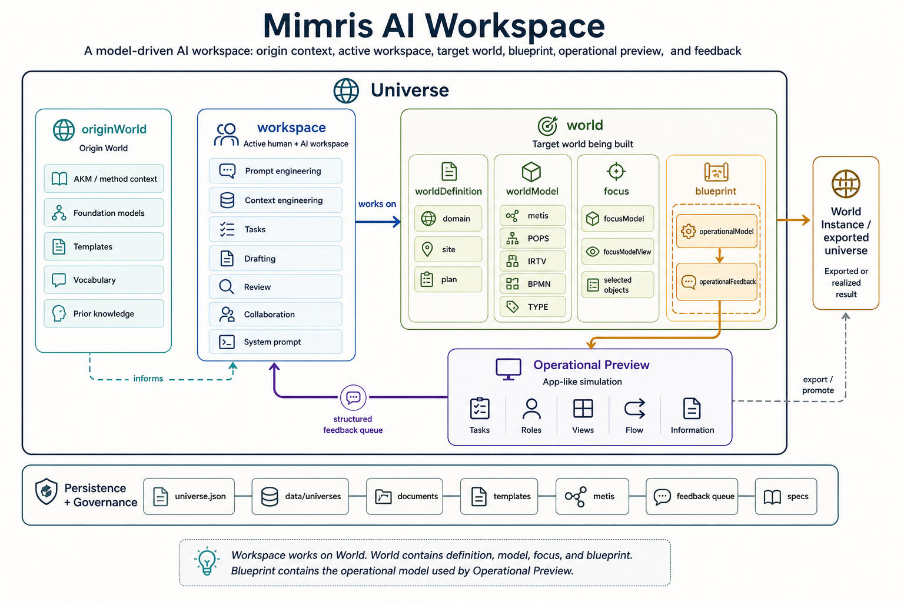

# Mimris AI Workspace

## Product Presentation

This presentation describes the product vision. Some capabilities are still under development.

Mimris AI Workspace is a model-driven work and collaboration platform for turning expert knowledge into operational workspaces, executable processes, and AI-assisted deliverables.

It helps organizations move from inherited knowledge and an early world definition to structured models, from those models to a blueprint, and from the blueprint to a practical operational preview where people and AI can test, refine, and execute work with shared context.

## One-Line Positioning

Mimris AI Workspace transforms domain knowledge into structured operational work, using AI through disciplined prompt engineering, context engineering, and model-driven traceability.

## The Problem

Organizations often have valuable knowledge spread across documents, expert conversations, process diagrams, templates, task lists, and informal workflows.

AI can help, but most AI tools operate on isolated prompts. They lack durable context, process structure, role awareness, provenance, and a reliable way to connect generated output back to the business model.

The result is familiar:

- AI outputs are useful but hard to govern.
- Context must be repeated manually.
- Process knowledge stays disconnected from daily work.
- Templates and methods are reused inconsistently.
- Operational feedback rarely improves the underlying model.
- Organizations get documents, not living work systems.

## The Mimris Approach

Mimris treats an organization, product, method, or service as a modeled world.

The product architecture separates:

- `Origin World`
  The inherited source or method context that informs the work, such as AKM, foundation models, templates, vocabulary, and prior domain knowledge.

- `Workspace`
  The active human and AI environment for defining, modeling, prompting, drafting, reviewing, and refining the target world.

- `World`
  The target world being built. It contains the world definition, world model, current focus, and blueprint.

- `Blueprint`
  The structured realization package inside the World. It contains the operational model and feedback queue used to preview and improve the next world.

- `Operational Preview`
  The app-like preview of the blueprint's operational model, used for testing, collaboration, feedback, and early execution validation.

This structure gives AI a stable operating environment. Instead of asking a model to improvise from a loose prompt, Mimris supplies the right task, context, controls, current artifact, model references, and feedback history.

## What The Product Does

Mimris supports the full path from understanding to execution:

1. Capture the world domain  
   Users define the target domain, goals, scope, terminology, and operating context.

2. Model the world  
   The Workspace helps users and AI structure the World using model layers such as POPS, IRTV, BPMN, and TYPE.

3. Generate a blueprint  
   Approved model outputs become a structured blueprint inside the World.

4. Preview operations  
   Operational Preview renders the blueprint's operational model as an app-like simulation of tasks, roles, views, flow, and information.

5. Execute work  
   The workspace supports manual and AI-assisted task execution, document drafting, review, approval, and artifact continuity.

6. Learn from feedback  
   Feedback from preview or execution is captured as structured change signals and routed back into design review.

## AI As Prompt And Context Engineering

Mimris is not just a chat interface. Its AI value comes from engineering the context around every AI request.

### Prompt Engineering

Mimris builds prompts from structured task semantics, not from free-form user text alone.

Each AI request can include:

- the active task and objective
- the task template
- relevant controls, standards, and guidance
- the current working artifact
- approved prior outputs
- process and role context
- model references from POPS, IRTV, BPMN, and TYPE
- user delta instructions
- provider and model controls

This makes AI behavior more repeatable, auditable, and aligned with the modeled work.

### Context Engineering

Mimris manages what context should be included, reduced, reused, or refreshed.

Instead of always sending everything, the platform can distinguish:

- first-run generation, where broad grounding is needed
- iteration, where the current artifact and focused delta instruction matter most
- compact domain anchors, where only the essential world context is needed
- rehydration, where full context is restored after domain changes, drift, or iteration thresholds

This reduces cost and noise while preserving semantic grounding.

### Model-Grounded AI

AI outputs are connected to the modeled world.

For example:

- POPS grounds process structure and operational coverage.
- IRTV grounds tasks, roles, views, and workbench structure.
- BPMN grounds executable flow paths, branches, exceptions, and rework.
- TYPE grounds information semantics, properties, validation hints, and relationships.

The AI does not simply produce text. It helps generate and refine structured artifacts that can be inspected, approved, persisted, previewed, and reused.

### Human-Governed AI

Mimris keeps people in control.

AI can draft, classify, summarize, propose changes, and help navigate the workspace. But canonical adoption remains review-driven.

Generated drafts become durable only when saved or approved. Preview feedback becomes a queue item before it becomes a work item or model change. This supports responsible AI use in operational environments.

## Core Product Capabilities

### Domain-To-Workspace Pipeline

Mimris turns a world definition into a structured work environment. The world definition is not just background text; it becomes the source for process modeling, task generation, templates, operational preview, and guided execution.

### Model-Driven Workbench

The Workbench gives users a practical execution surface for tasks, documents, model outputs, and review flows. It combines human work, AI assistance, artifact history, and modeled context in one place.

### Operational Preview

Operational Preview lets teams test the blueprint before turning it into a full implementation or exported world instance. It presents an app-like runtime view with tasks, roles, workflows, views, and information bindings.

This helps teams validate whether the model describes a usable operational system.

### Structured Feedback Loop

Feedback is captured with context:

- selected activity
- resolved workspace
- selected task
- active role
- source model trace
- likely target model

This makes feedback actionable and prevents valuable review insight from disappearing into disconnected comments.

### Origin And Foundation Reuse

Mimris can use origin-world models, foundation models, templates, and method contexts without confusing them with the world currently being built.

This is important for organizations that want reusable methods while still preserving the identity of each target world.

## Why This Matters

Most AI productivity tools help users create isolated outputs.

Mimris is designed to create continuity:

- continuity from domain knowledge to model
- continuity from model to blueprint
- continuity from blueprint to operational preview
- continuity from task execution to approved artifacts
- continuity from feedback back into design improvement

This makes Mimris suitable for complex domains where context, traceability, and governance matter.

## Target Users

Mimris is relevant for:

- consultants designing client operating models
- domain experts turning knowledge into structured methods
- organizations building AI-assisted internal workspaces
- teams creating repeatable service delivery processes
- product teams turning process knowledge into app specifications
- regulated or knowledge-heavy environments that require traceability

## Example Use Cases

### Consulting Delivery

A consulting team captures a client domain, models its operating processes, generates task structures, drafts deliverables with AI, and maintains traceability from advice back to the modeled domain.

### Service Operations

An organization models a service workflow, previews how roles and tasks behave, captures feedback, and turns the approved blueprint into operational workspace behavior.

### Product And App Specification

A product team uses Mimris to move from domain definition to world model, then to a generated world app spec with roles, workflows, screens, information entities, and task patterns.

### AI-Assisted Knowledge Work

Teams use AI to draft documents and model outputs, but every AI request is grounded in the active task, current artifact, domain anchor, templates, and model context.

## Differentiation

Mimris differs from ordinary AI workspaces because it is:

- model-driven, not prompt-only
- context-engineered, not chat-only
- artifact-centered, not message-centered
- human-governed, not auto-committing
- reflective, not one-way generation
- designed for reusable domain and process knowledge

## Product Vision

Mimris aims to become an environment where organizations can design, preview, execute, and continuously improve operational worlds.

AI is a core capability, but the product value is not only the model call. The value is in the engineered context around the call: the origin world, the workspace, the target world, the task, the controls, the current artifact, the structured model, the blueprint, and the feedback loop.

In Mimris, prompt engineering becomes part of the product architecture, and context engineering becomes the bridge between human expertise, structured models, and reliable AI-assisted work.
